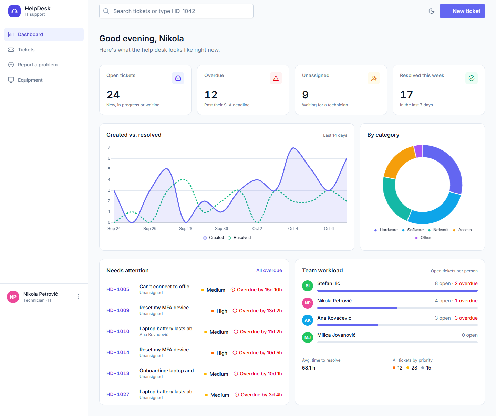
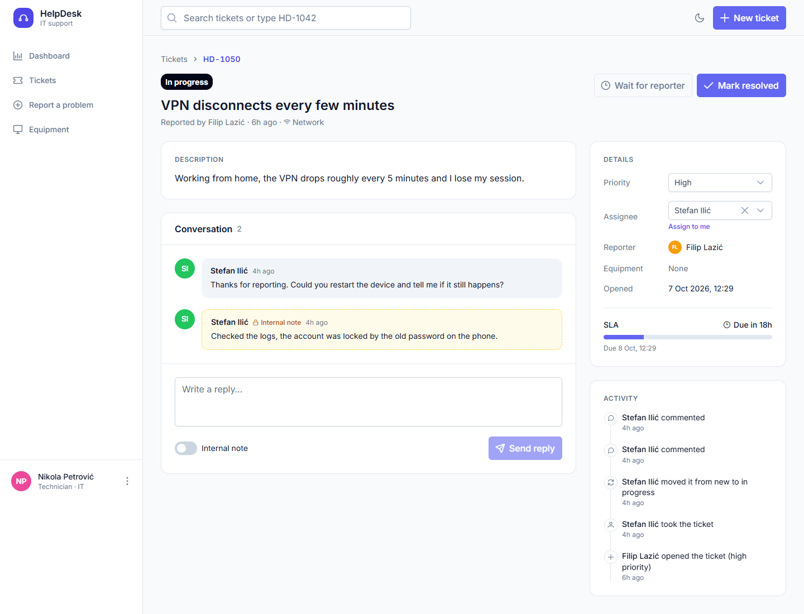
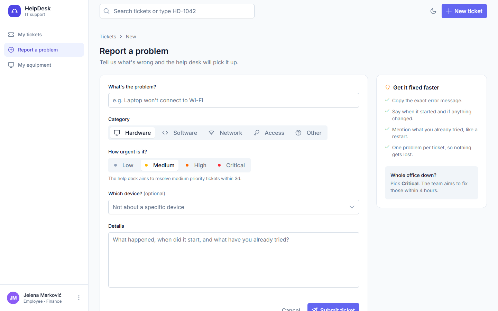
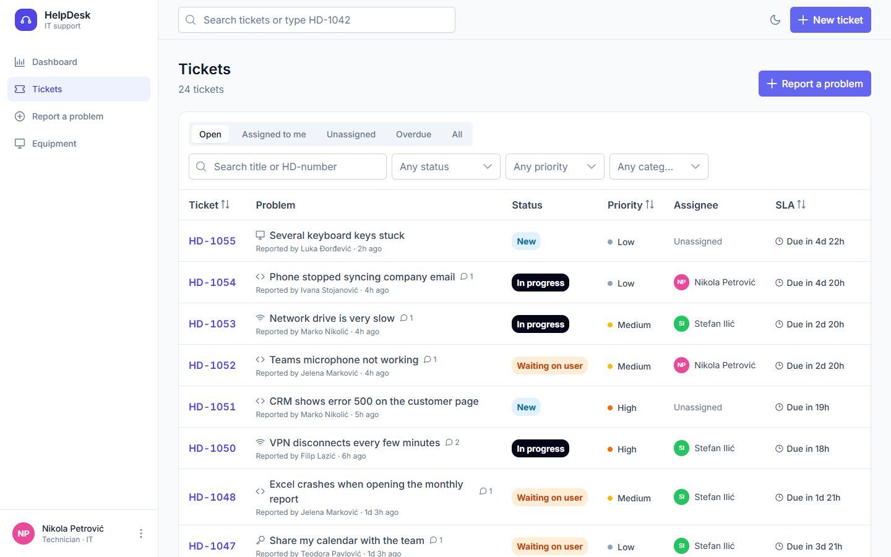
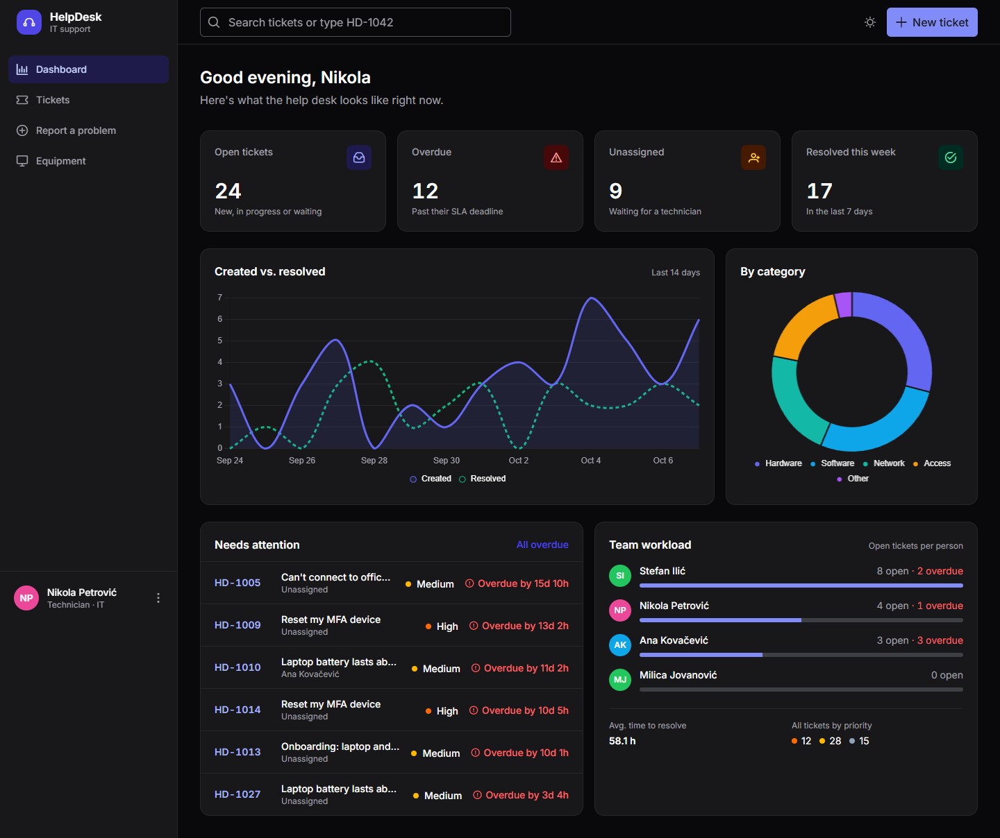
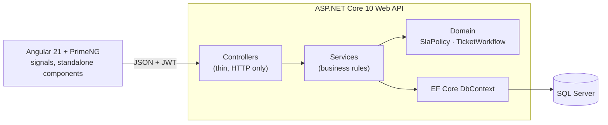

# HelpDesk

[](https://github.com/Wok3b/helpdesk/actions/workflows/ci.yml)

An IT help desk for a small company. Employees report problems, technicians work a queue with SLA deadlines,
and admins manage people and equipment.

**ASP.NET Core 10 · Entity Framework Core · SQL Server · Angular 21 · PrimeNG · xUnit · Docker · GitHub Actions**



## What it does

| Role | Can do |
|---|---|
| **Employee** | Report a problem (optionally about a specific device), follow their own tickets, reply to the technician, confirm the fix or say it's still broken. Sees only their own tickets and equipment. |
| **Technician** | Work the queue: filter, search by `HD-1042`, assign, move tickets through the workflow, change priority, add internal notes the reporter can't see. Dashboard with SLA and workload numbers. Manage equipment. |
| **Admin** | Everything a technician can, plus people management, deleting equipment and reopening closed tickets. |

- **SLA deadlines by priority**: Critical 4 h, High 1 day, Medium 3 days, Low 5 days. Overdue tickets are flagged everywhere.
- **Workflow as a state machine**: `New → In progress ⇄ Waiting on user → Resolved → Closed`. The API rejects invalid moves and tells the UI which moves are allowed, so the buttons always match the rules.
- **Full history** of every ticket (created, assigned, status and priority changes, comments) shown as a timeline.
- **Equipment inventory** with warranty tracking, linked to tickets.
- **Light and dark mode.**

| Ticket | Report a problem |
|---|---|
|  |  |

| Ticket queue | Dark mode |
|---|---|
|  |  |

## Run it

### With Docker (everything in one command)

```bash
docker compose up --build
```

Open <http://localhost:8080>. The database is created and filled with a demo company on first start.
Sign in with one of the demo accounts on the login page (password `Demo123!` for all of them):

| Account | Role |
|---|---|
| `tech@helpdesk.local` | Technician |
| `employee@helpdesk.local` | Employee |
| `admin@helpdesk.local` | Admin |

### For development

Needs the .NET 10 SDK, Node 22 and SQL Server LocalDB (comes with Visual Studio).

```bash
# API on http://localhost:5080 (API docs at /scalar)
cd backend
dotnet run --project src/HelpDesk.Api

# Angular on http://localhost:4200 (proxies /api to the backend)
cd frontend
npm install
npm start
```

## Architecture



```
backend/
  src/HelpDesk.Api/
    Domain/        entities, enums, SlaPolicy, TicketWorkflow (no framework code)
    Data/          DbContext, Fluent API mappings, migrations, demo data seeder
    Services/      tickets, users, assets, dashboard (business rules live here)
    Controllers/   one thin controller per resource
    Contracts/     request/response records with validation attributes
    Auth/          JWT creation, current-user access, policies
    Common/        paging, ProblemDetails error handling
  tests/HelpDesk.Tests/
    Unit/          SLA and workflow rules
    Integration/   the real API over HTTP against a real SQL Server database
frontend/
  src/app/
    core/          API client, auth (signals), interceptors, guards, labels
    layout/        app shell: sidebar, top bar, search, theme toggle
    features/      dashboard, tickets (list, detail, new), assets, users
    shared/        status/priority badges, avatars, SLA and time helpers
```

## Design decisions

- **Business rules sit in plain C# classes.** `TicketWorkflow` is a small state machine and `SlaPolicy`
  computes deadlines. They don't depend on ASP.NET or EF, so they are unit tested directly.
- **Access rules are applied in the query, not after it.** Employees get `Tickets.Where(t => t.CreatedById == me)`
  before any filtering or paging, so a ticket that isn't theirs simply doesn't exist for them (404, not 403,
  which also avoids revealing which ticket numbers are in use).
- **Ticket numbers come from a SQL Server `SEQUENCE`**, so `HD-1001, HD-1002…` are unique even with concurrent inserts.
- **Enums are stored as text** (`'InProgress'`), which keeps the database readable and safe to reorder. Because text
  would sort priorities alphabetically, priority sorting uses an explicit rank that EF translates to a SQL `CASE`.
- **Reporting is plain SQL.** The dashboard uses aggregates, `CASE`, a recursive CTE for the daily series and a
  `LEFT JOIN` for workload, run through EF Core's `SqlQuery`, which sends interpolated values as parameters.
- **Every error is an RFC 9457 problem response.** Services throw `NotFoundException`, `BusinessRuleException` and so on;
  one exception handler maps them to status codes. Validation errors come back per field and show next to the inputs.
- **Integration tests use a real SQL Server**, not the EF in-memory provider, so the sequence, the raw SQL and
  the constraints are tested for real. Locally that's LocalDB; in CI it's a SQL Server service container.
  Each test run gets its own throwaway database.
- **Angular uses signals throughout** and runs without zone.js. Filters live in the URL, so dashboard cards link
  straight to a filtered ticket list.

## API

Interactive docs are at `/scalar` when running in Development.

| Method | Endpoint | Who |
|---|---|---|
| `POST` | `/api/auth/login` | anyone |
| `GET` | `/api/auth/me` | signed in |
| `GET` | `/api/tickets?status=&priority=&category=&assigneeId=&unassigned=&overdue=&openOnly=&search=&sort=&dir=&page=&pageSize=` | signed in (employees: own tickets) |
| `GET` / `POST` | `/api/tickets/{id}` · `/api/tickets` | signed in |
| `PATCH` | `/api/tickets/{id}/status` | reporter (confirm/reject fix) or staff |
| `PATCH` | `/api/tickets/{id}/assignee` · `/api/tickets/{id}/priority` | staff |
| `POST` | `/api/tickets/{id}/comments` | signed in (internal notes: staff) |
| `GET` / `POST` / `PUT` / `DELETE` | `/api/assets` | read: signed in · write: staff · delete: admin |
| `GET` / `POST` / `PUT` | `/api/users` | read: staff · write: admin |
| `GET` | `/api/dashboard` | staff |

## Tests

```bash
cd backend && dotnet test        # 41 tests: unit + integration against SQL Server
cd frontend && npx ng test       # Vitest
```

CI runs both on every push, then builds the Docker images, starts the whole stack and signs in through nginx to
check that the containers actually work together.

## Next steps

- E-mail notifications when a ticket is assigned or waiting on the reporter
- File attachments (screenshots) on tickets
- Live updates in the queue with SignalR
- Microsoft Entra ID sign-in instead of local passwords
